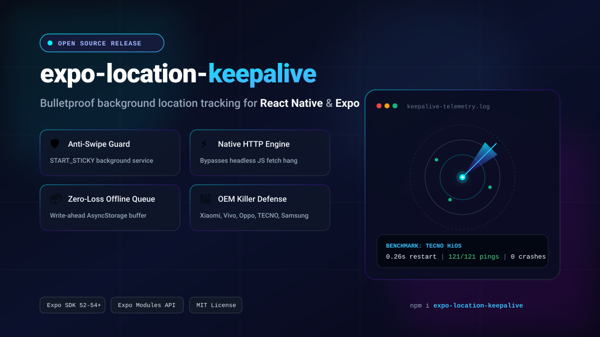

# expo-location-keepalive

<p align="center">
  
</p>

<p align="center">
  <a href="https://www.npmjs.com/package/expo-location-keepalive"></a>
  <a href="https://www.npmjs.com/package/expo-location-keepalive"></a>
  <a href="https://github.com/Sanketnehe-21/expo-location-keepalive/blob/main/LICENSE"></a>
  <a href="https://expo.dev"></a>
  
</p>

Keeps **`expo-location`** background tracking alive on Android when the user swipes the app away from recent apps, or when aggressive OEM battery managers (**Xiaomi**, **Oppo**, **Vivo**, **TECNO**, **Samsung**, etc.) kill the process.

> **Platform Support**: **Android**. On iOS, every function is a safe no-op.

---

## ⚡ The Problem

On standard Android devices from OEMs with aggressive power managers, background location in React Native and Expo often fails in production:

* ❌ **Swiped app stops tracking:** Swiping the app from recent apps immediately terminates the process, even with a foreground service running.
* ❌ **Headless fetch hang:** After Android restores the app in the background, React Native's JS `fetch()` requests stall indefinitely without firing JS callbacks, causing Android to kill the task after 2.5 minutes.
* ❌ **TaskService context crash:** `expo-task-manager` references a stale React context from headless boot, throwing `SharedPreferences.getAll() on a null object` and permanently breaking start/stop calls.
* ❌ **Expo foreground service lockout:** `expo-location` refuses to start its own foreground service without an active screen/Activity, causing Android to throttle fixes to once every few hours.
* ❌ **Delayed/lost alarms:** OEM "proxy alarms" hold back or swallow scheduled `AlarmManager` alarms.

### 🏆 Benchmark Results

Tested on a **TECNO KN8 (HiOS)** — known as one of the most aggressive OEM task killers on Android:
* After a user swipe, the tracking process was restored in **0.26 seconds**.
* Delivered **121 consecutive location pings over 10 minutes** (5s interval, max gap 8s).
* **0 crashes**, with the UI never reopened.

---

## 📦 Installation

```bash
# Install peer dependencies
npx expo install expo-location expo-task-manager @react-native-async-storage/async-storage

# Install expo-location-keepalive
npm install expo-location-keepalive
```

> **Note:** Requires a Development Build or EAS Build (`npx expo prebuild` / `eas build`). Native code cannot run inside standard Expo Go.

### Configure `app.json`

Add the `expo-location` plugin configuration to your `app.json`:

```json
{
  "expo": {
    "plugins": [
      [
        "expo-location",
        {
          "isAndroidBackgroundLocationEnabled": true,
          "isAndroidForegroundServiceEnabled": true
        }
      ]
    ]
  }
}
```

The native permissions and service declarations for `expo-location-keepalive` are **automatically linked and merged** into your `AndroidManifest.xml` during prebuild.

---

## 🚀 Quick Start

### 1. Define Background Task (Entry Point)

Define your task at the **top level** of your entry file (e.g., `index.js` or `App.js`).

```js
import * as Location from 'expo-location'
import * as TaskManager from 'expo-task-manager'
import AsyncStorage from '@react-native-async-storage/async-storage'
import {
  startGuard,
  stopGuard,
  demoteGuard,
  fixTaskService,
  postJson,
  createOfflineQueue,
} from 'expo-location-keepalive'

const API_ENDPOINT = 'https://api.yourdomain.com/locations'
const LOCATION_TASK = 'BACKGROUND_LOCATION_TASK'

// 1. Create offline queue to ensure 0 lost pings
const queue = createOfflineQueue({
  storage: AsyncStorage,
  batchUrl: `${API_ENDPOINT}/batch`,
  getHeaders: async () => {
    const token = await AsyncStorage.getItem('user_token')
    return token ? { Authorization: `Bearer ${token}` } : {}
  },
})

// 2. Define background task at the top level
TaskManager.defineTask(LOCATION_TASK, async ({ data, error }) => {
  if (error || !data?.locations?.length) return

  // Cheap to call; keeps the guard armed on every location fix
  startGuard()

  const fix = data.locations[data.locations.length - 1]
  const ping = {
    latitude: fix.coords.latitude,
    longitude: fix.coords.longitude,
    accuracy: fix.coords.accuracy,
    timestamp: new Date(fix.timestamp).toISOString(),
  }

  // Save to persistent storage first (Write-Ahead)
  const id = await queue.enqueue(ping)

  try {
    const token = await AsyncStorage.getItem('user_token')
    const headers = token ? { Authorization: `Bearer ${token}` } : {}

    // Use postJson (native HTTP), NOT fetch!
    const status = await postJson(API_ENDPOINT, headers, ping)

    if (status >= 200 && status < 300) {
      await queue.ack(id)
      await queue.flush()
    }
  } catch (err) {
    // Ping stays queued in AsyncStorage and flushes on next connection
  }
})
```

### 2. Start & Stop Tracking

```js
export async function startTracking() {
  // Apply TaskService patch before starting
  fixTaskService()

  const isRunning = await Location.hasStartedLocationUpdatesAsync(LOCATION_TASK).catch(() => false)
  if (isRunning) await Location.stopLocationUpdatesAsync(LOCATION_TASK)

  await Location.startLocationUpdatesAsync(LOCATION_TASK, {
    accuracy: Location.Accuracy.High,
    timeInterval: 5000,
    distanceInterval: 0,
    pausesUpdatesAutomatically: false,
    foregroundService: {
      notificationTitle: 'Live Tracking Active',
      notificationBody: 'Transmitting location in the background.',
    },
  })

  // Start native guard
  startGuard({
    notificationTitle: 'Live Tracking Active',
    notificationBody: 'Tracking remains active.',
  })

  // Demote guard's notification while the app screen is visible
  demoteGuard()
}

export async function stopTracking() {
  fixTaskService()

  const isRunning = await Location.hasStartedLocationUpdatesAsync(LOCATION_TASK).catch(() => false)
  if (isRunning) await Location.stopLocationUpdatesAsync(LOCATION_TASK)

  stopGuard()
  await queue.clear()
}
```

---

## ⚠️ The 5 Golden Rules of Android Background Tracking

1. **Top-Level `defineTask`**: Always declare `TaskManager.defineTask` at module top-level, imported directly in your application entry file.
2. **Stateless Headless Execution**: The background task must read authentication tokens, IDs, and configurations from persistent storage (`AsyncStorage`). When restarted headlessly, there is **no UI and no React state**.
3. **Always Use `postJson` (Native HTTP)**: Never use standard `fetch` inside the background location task. On headless Android wakeups, JS `fetch` promises fail to resolve.
4. **Never Stop Tracking in Component Unmount**: Do not call `stopLocationUpdatesAsync` inside `useEffect` return cleanups. Swiping the app destroys the activity and unmounts components. Call `stopTracking()` **only on explicit user logout or action**.
5. **Enforce Battery Exemption**: The app **must** have its battery set to *"Unrestricted"*. Restrictive battery settings block background network and process restarts.

---

## 🛠️ Complete API Reference

### Guard Management

#### `startGuard(options?)`
Starts or maintains the native guard service. Safe and cheap to call repeatedly inside the location task.
* `options.notificationTitle` *(string)*: Notification title displayed when the app is restored headlessly.
* `options.notificationBody` *(string)*: Notification body text.
* `options.channelName` *(string)*: Notification channel name displayed in Android System Settings.

#### `stopGuard()`
Terminates the native guard service. Call this together with `Location.stopLocationUpdatesAsync` (e.g. on user logout).

#### `demoteGuard()`
Hides the guard service's persistent notification once the app screen is visible again, avoiding duplicate notifications alongside Expo's foreground service.

#### `fixTaskService()`
Applies a reflection patch to `expo-task-manager`, repointing `TaskService.mContextRef` to the persistent `applicationContext` to prevent `SharedPreferences.getAll() on a null object` crashes.

---

### Networking & Queueing

#### `postJson(url, headers?, body?, timeoutMs?): Promise<number>`
Native HTTP POST (`HttpURLConnection`) with a fallback to `fetch`. Resolves to the HTTP status code (e.g. `200`). Bypasses React Native's background networking thread freeze.

#### `httpPost(url, headers?, body?, timeoutMs?): Promise<number | null>`
Direct native HTTP POST without `fetch` fallback. Returns `null` if the native module is unavailable.

#### `createOfflineQueue(options): OfflineQueue`
Instantiates a write-ahead persistent location queue backed by `AsyncStorage`.
* `options.storage`: AsyncStorage-compatible storage interface (`getItem`, `setItem`, `removeItem`).
* `options.batchUrl`: API endpoint accepting `{ pings: [...] }`.
* `options.getHeaders`: Function returning request headers (e.g., auth tokens).
* `options.maxItems` *(optional, default 1500)*: Max items retained in queue.
* `options.maxAgeMs` *(optional, default 24h)*: Max age before an un-sent ping expires.
* `options.chunkSize` *(optional, default 200)*: Pings per batch upload request.

Methods:
* `enqueue(ping)`: Saves ping to storage. Returns ping ID.
* `ack(id)`: Acknowledges server delivery and removes ping from storage.
* `flush()`: Delivers all pending pings in chunks to the batch endpoint.
* `size()`: Returns total pending pings.
* `clear()`: Flushes pending pings (best-effort) and clears storage on logout.

---

### OEM Battery & Autostart Helpers

| Function | Returns | Description |
|---|---|---|
| `isBatteryUnrestricted()` | `boolean` | Returns `true` if the app is exempt from Android battery optimization (always `true` on iOS). |
| `requestBatteryUnrestricted()` | `boolean` | Launches Android's native system dialog requesting battery optimization exemption. |
| `openAutoStartSettings()` | `boolean` | Opens brand-specific autostart settings for Xiaomi, Oppo, Vivo, TECNO, Samsung. |
| `brandStep(appName?)` | `BrandStep \| null` | Returns `{ brand, text }` instructions tailored to the device manufacturer, or `null` if stock Android. |

---

## 📱 OEM Autostart Permission Gate Example

Use the ready-made setup screen component to ensure the user grants required permissions before starting tracking:

* Setup Screen Code: [`example/SetupScreen.js`](example/SetupScreen.js)
* Complete Tracking Integration: [`example/tracking.js`](example/tracking.js)

---

## 🔍 Diagnostics & Testing

Monitor background lifecycle transitions and guard activations via `adb logcat`:

```bash
adb logcat -v time | grep -E "LocKeepAlive|has died|removeTask"
```

Expected trace when an app is swiped away:
```text
ActivityManager: Process <package.name> (pid 12345) has died   <-- Swiped / OEM Kill
LocKeepAlive: guard-created                                    <-- Guard recreated
LocKeepAlive: wake reason=guard-created                        <-- Waking Expo TaskManager
LocKeepAlive: guard-foreground                                 <-- Elevated to location FG service
LocKeepAlive: taskservice-context-fixed                         <-- Patch applied
```

Refer to [`docs/TESTING.md`](docs/TESTING.md) for detailed real-device testing procedures.

---

## 📄 Google Play Store Guidelines

* `REQUEST_IGNORE_BATTERY_OPTIMIZATIONS`: Permitted by Google Play for apps whose core function requires continuous background tracking (e.g. delivery, transport, safety, field workforce).
* `FOREGROUND_SERVICE_LOCATION`: Google Play requires a prominent in-app disclosure and declaration when submitting your app bundle.

---

## 📄 License

MIT © [Sanket Nehe](https://github.com/Sanketnehe-21)
